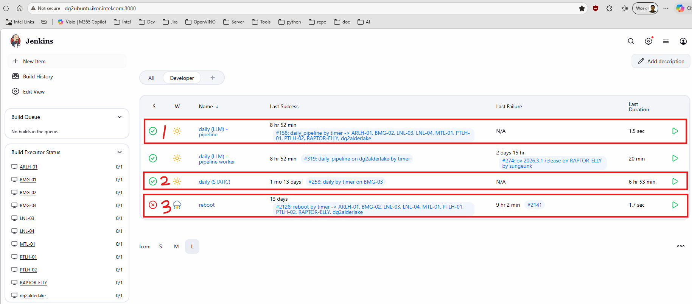

## Screenshot


## Builds
1. [daily (LLM) - pipeline](http://dg2ubuntu.ikor.intel.com:8080/job/daily%20(LLM)%20-%20pipeline)

    **Parameters**

    > Some parameters are intended for Jenkins debugging.

    - `DOWNLOAD_URL`: CPack URL. Check that the prebuilt package was built successfully. `This will be updated later so the PR number and commit ID can be entered more simply.`
    - `TARGET_MACHINE`: Select the machine that will run the test.
    - `PURPOSE`: Keyword used to identify the build. This is usually used for PR testing, so a value like `PR#12345 fix primitive issue` is recommended. It is used as the HTML report title and for filtering builds.
    - `MAIL_LIST`: Email recipients. Separate multiple addresses with `,`.
    - `SHORT_TEST`: *For Jenkins debugging.* Deprecated.
    - `TIMEOUT`: *For Jenkins debugging.* Cancels a test when it hangs. Default: 1800 seconds.
    - `MODEL_CACHE`: *For Jenkins debugging.* Selects a specific weekly model cache by name, such as `WW24_llm-optimum_2026.3.0-22130` or `WW20_llm-optimum_2026.2.0-21894-RC1`. This only works when the model exists on the target machine.
    - `RUN_DAILY_ROOT_TEMP`: *For Jenkins debugging.* Uses a `run_daily` repository from a specific location.
    - `MODEL_FILTER`: Selects the models to test.

2. [daily (STATIC)](http://dg2ubuntu.ikor.intel.com:8080/job/daily%20(STATIC))

    `Most static models are failing on BMG machines because the reference data has not been updated.`

3. [reboot](http://dg2ubuntu.ikor.intel.com:8080/job/reboot)

## Daily LLM/VLM benchmark commands

The `daily (LLM) - pipeline` job benchmarks each selected model with `llm_bench/benchmark.py`. This command shows the shared options; visual-text models add `-t visual_text_gen`. It uses the default PA configuration (overridable with `LLM_BENCH_CONFIG`) and the `OV_FP16-4BIT_DEFAULT` model export. The exact command for each run is saved with its test result.

```text
python <repo>/openvino.genai/tools/llm_bench/benchmark.py \
    -m <model_path> \
    -d <device> \
    -mc 1 \
    -ic 256 \
    -n 3 \
    --apply_chat_template \
    --disable_prompt_permutation \
    --cb_config "{\"enable_prefix_caching\": false, \"max_num_batched_tokens\": 99999999}" \
    --load_config "{\"ATTENTION_BACKEND\": \"PA\"}" \
    -pf <prompt_file> \
    -rj <json_report>
```

**Default (no `-t`):** `gemma-2-9b-it`, `gemma-4-26b-a4b-it`, `gemma-4-e2b-it`, `gpt-oss-20b`, `llama-2-7b-chat-hf`, `llama-3.1-8b-instruct`, `llama-3.2-1b-instruct`, `minicpm4-0.5b`, `minicpm4-8b`, `mistral-7b-instruct-v0.2`, `phi-3.5-mini-instruct`, `phi-3.5-vision-instruct`, `phi-4-mini-instruct`, `qwen3-8b`, `qwen3-vl-4b-instruct`.

**Visual-text (add `-t visual_text_gen` after `--apply_chat_template`):** `gemma-3-4b-it`, `phi-4-multimodal-instruct`, `qwen3.5-9b`, `qwen3.6-35b-a3b`.

The grouping follows the command, not the model name: `phi-3.5-vision-instruct` and `qwen3-vl-4b-instruct` do not pass `-t visual_text_gen`.

`MODEL_FILTER` can further narrow which cases Jenkins runs.

## Image generation benchmark commands

The image generation cases run `llm_bench/benchmark.py` in GenAI mode. All three use the first (32-token) prompt and the same command shape; the model export differs by precision. The exact command is saved with each test result.

```text
python <repo>/openvino.genai/tools/llm_bench/benchmark.py \
    -m <model_path> \
    -d <device> \
    -mc 1 \
    -n 3 \
    --genai \
    --static_reshape \
    --output_dir <output_dir> \
    -pf <prompt_file> \
    -pi 0
```

| Model | Export precision |
|---|---|
| `flux.1-schnell` | `OV_FP16-INT4_SYM_CW` |
| `stable-diffusion-v1-5` | `FP16` |
| `stable-diffusion-3.5-large-turbo` | `OV_FP16-4BIT_DEFAULT` |

## Machines
The skipped-model column reflects the daily GPU skip policy when the LLM pipeline runs. Machines without that pipeline show N/A.

| machine | platform | target device | support builds | skipped LLM models | note |
|---|---|---|---|---|---|
| ARLH-01 | ARLH (140T) | GPU | `daily (LLM) - pipeline` | `qwen3.6-35b-a3b` |  |
| BMG-01 |  | GPU |  | N/A |  |
| BMG-02 | BMG (B580) | GPU.1 | `daily (LLM) - pipeline` | `gemma-4-26b-a4b-it`, `gpt-oss-20b`, `qwen3.6-35b-a3b` |  |
| BMG-03 |  | GPU | `daily (STATIC)` | N/A |  |
| LNL-03 | LNL (140V) | GPU |`daily (LLM) - pipeline`| `qwen3.6-35b-a3b` |  |
| LNL-04 | LNL (140V) | GPU |`daily (LLM) - pipeline`| `qwen3.6-35b-a3b` |  |
| MTL-01 | MTL | GPU |`daily (LLM) - pipeline`| `gemma-4-26b-a4b-it`, `gpt-oss-20b`, `qwen3.6-35b-a3b` |  |
| PTLH-01 | PTLH (B390) | GPU |`daily (LLM) - pipeline`| None |  |
| PTLH-02 | PTLH (B390) | GPU |`daily (LLM) - pipeline`| None |  |
| RAPTOR-ELLY | BMG (B70) | GPU.1 |`daily (LLM) - pipeline`| None |  |
| dg2alderlake | DG2 (A770) | GPU.1 |`daily (LLM) - pipeline`| `qwen3.6-35b-a3b` |  |
